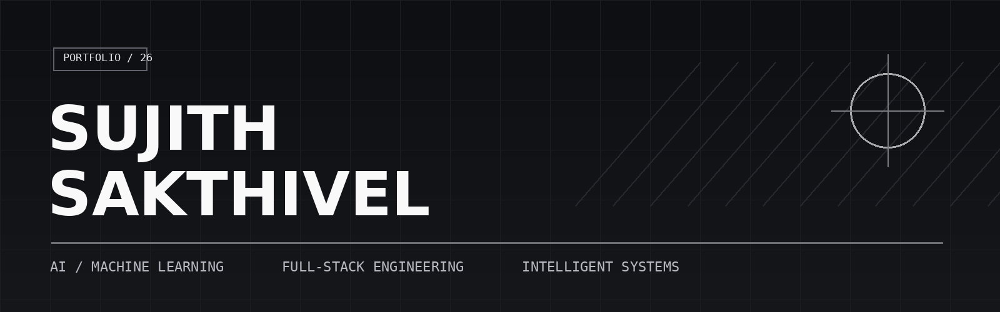
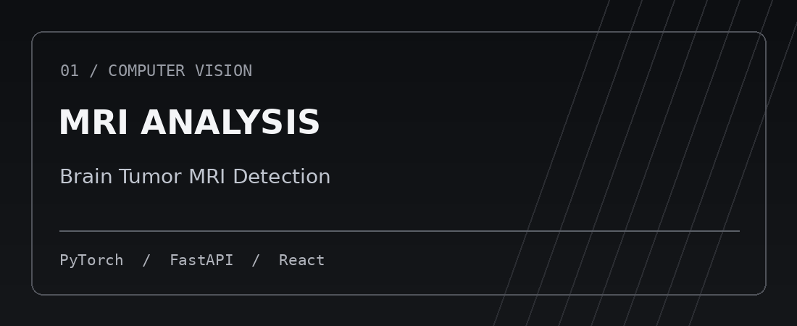
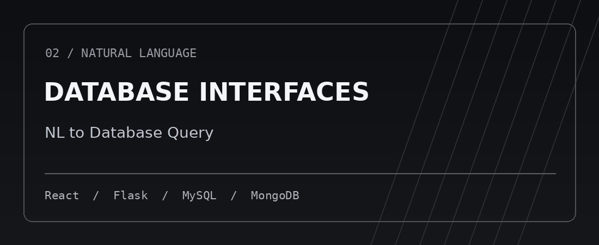
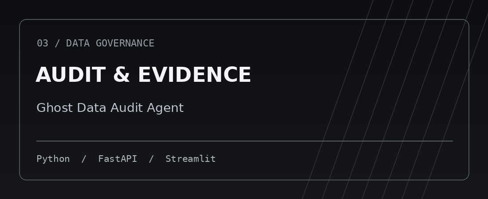

<!-- Minimal editorial profile. Artwork is stored locally in assets/. -->

  

  <strong>Building useful software, from models to production-minded systems.</strong>

  
  

---

### 01 — About

I'm **Sujith Sakthivel**, a developer working across **AI/ML**, **full-stack applications**, and **data-intensive systems**. I like solving real problems end to end: shaping the model, building the APIs, and making the interface useful.

- **I build:** applied AI tools, web platforms, developer utilities.
- **I care about:** explainability, thoughtful interfaces, system design, and reliable behavior.
- **I'm exploring:** computer vision, natural-language data interfaces, and intelligent infrastructure.

### 02 — Featured engineering

> An MRI analysis and clinical decision-support **prototype** combining model inference with explainability and a full-stack application. Not a validated medical device.
>
> **[Explore source →](https://github.com/sujith-sakthivel04/brain-tumor-mri-detection)**

> A multi-tenant platform for interacting with MySQL and MongoDB through natural language, with authentication, access controls, and audit logging.
>
> **[Explore source →](https://github.com/sujith-sakthivel04/nl-to-db-query)**

> A local-first application that reconstructs deletion state from supplied records and evidence using a deterministic, explainable audit engine.
>
> **[Explore source →](https://github.com/sujith-sakthivel04/ghost-data-audit-agent)**

**Also in the lab:** [Skill Gap Analyzer](https://github.com/sujith-sakthivel04/skill-gap-analyzer) · [Other repositories](https://github.com/sujith-sakthivel04?tab=repositories)

### 03 — Technology

**Languages & interfaces**

   

**Frameworks & data**

      

### 04 — Open source & activity

  

*The live contribution image is provided by an external service; GitHub's own contribution calendar is available on [my profile](https://github.com/sujith-sakthivel04).*

---

Designed for clarity. Built through curiosity. · <a href="https://github.com/sujith-sakthivel04">sujith-sakthivel04</a>

